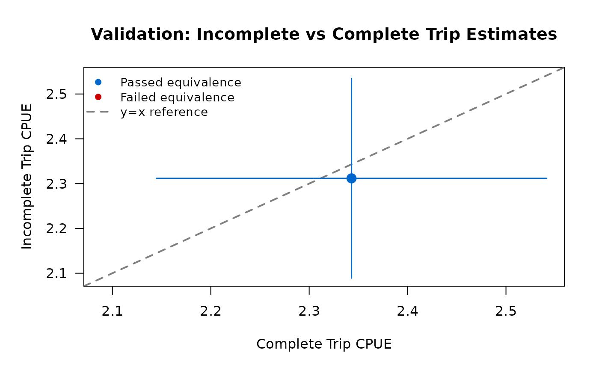
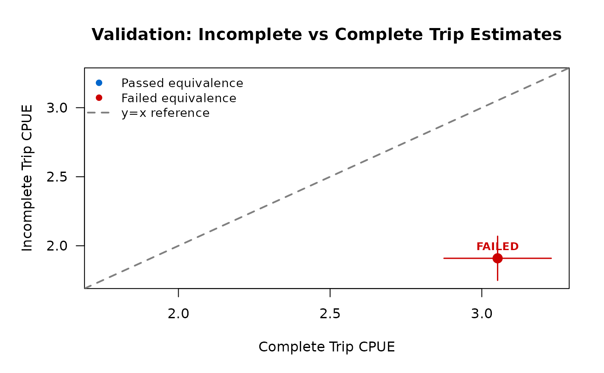

# Incomplete-Trip Interviews

## The task

An interview with an angler who is still fishing records the catch and
hours *so far*: an incomplete trip. This page covers how tidycreel
estimates a catch rate from incomplete trips, how to check those rates
against complete trips, and what the package will not do with them.

## What the sources say

- **Two estimators, one for each kind of trip.** For complete trips the
  catch rate is the ratio of means, total catch over total effort. For
  incomplete trips it is the mean of the individual catch rates, leaving
  out very short trips (say, under half an hour), whose rates are
  dominated by chance (Pollock et al. 1994, section 15.3.3.5).
- **Why the mean of ratios for incomplete trips.** A roving clerk meets
  a party in proportion to how long it fishes. Under that length-biased
  selection, and with a catch rate that does not change over the trip (a
  stationary fishing process), the mean of ratios has approximately the
  right expectation once trips under 30 minutes are dropped; it also had
  the smaller mean squared error in their simulations (Hoenig et
  al. 1997).
- **The risk.** If the catch rate changes during a trip, rates from
  trips caught part-way through misstate it: length-of-stay bias.
  Pollock et al. (1994, p. 230) report evidence ranging “from negligible
  to substantial” and advise checking roving rates against complete-trip
  data from the same fishery.

[`vignette("estimator-choice")`](https://chrischizinski.com/tidycreel/dev/articles/estimator-choice.md)
explains how the package picks between the two estimators.

## What tidycreel does by default

The interview type decides:

| Design | Default rate |
|----|----|
| Access point (`interview_type = "access"`, the default) | ratio of means on complete trips |
| Roving (`interview_type = "roving"`) | mean of ratios on all trips, trips under `truncate_at` (0.5 h) removed |

Naming `use_trips` or `estimator` turns the default off. The `method`
field records which estimator ran:

``` r

roving_design <- creel_design(example_calendar, date = date, strata = day_type) |>
  add_counts(prep_counts_daily_effort(example_counts,
    date = date, strata = day_type, daily_effort = effort_hours
  )) |>
  add_interviews(
    example_interviews,
    catch = catch_total, effort = hours_fished, n_anglers = n_anglers,
    harvest = catch_kept, trip_status = trip_status,
    trip_duration = trip_duration,
    interview_type = "roving"
  )
#> ℹ Added 22 interviews: 17 complete (77%), 5 incomplete (23%)

estimate_catch_rate(roving_design)$method
#> ℹ Roving design: using all 22 interviews for CPUE via MOR [auto]
#>   (17 complete, 5 incomplete)
#>   Override with `use_trips = 'complete'` for access-point estimation.
#> ℹ MOR truncation: 0 trips excluded (all >= 0.5 hours)
#> Warning: Small sample size for CPUE estimation.
#> ! Sample size is 22. Ratio estimates are more stable with n >= 30.
#> ℹ Variance estimates may be unstable with n < 30.
#> ℹ Repeats on this design are recorded, not printed: see `get_warnings()`.
#> [1] "mean-of-ratios-cpue"
estimate_catch_rate(roving_design, use_trips = "complete")$method
#> ℹ Using complete trips for CPUE estimation
#>   (n=17, 77.3% of 22 interviews)
#> [1] "ratio-of-means-cpue"
```

On a roving design the unspecified default uses every interview,
finished or not. If you need complete trips only, name
`use_trips = "complete"`. The first call warns that 22 interviews is a
small sample for a rate; the example dataset is small.

## Estimating from incomplete trips on an access design

The rest of the page uses a simulated access-point survey with 50
complete and 120 incomplete trips. The catch rate is the same, about 2.4
fish per hour, for both, so the two kinds of trip should agree.

``` r

simulate_survey <- function(seed, n_complete, n_incomplete,
                            rate_complete, rate_incomplete,
                            hours_complete, hours_incomplete) {
  set.seed(seed)
  calendar <- data.frame(
    date = seq.Date(as.Date("2024-06-01"), as.Date("2024-06-14"), by = "day"),
    day_type = rep(c("weekday", "weekend"), length.out = 14)
  )
  # Angler-hours for each sampled day
  daily <- data.frame(
    date = calendar$date, day_type = calendar$day_type,
    effort_hours = round(runif(14, min = 50, max = 150))
  )
  trips <- function(n, status, hours, rate) {
    x <- data.frame(
      date = sample(calendar$date, n, replace = TRUE),
      hours_fished = runif(n, hours[1], hours[2]),
      trip_status = status
    )
    x$trip_duration <- x$hours_fished # hours so far, for an incomplete trip
    x$catch_total <- rpois(n, lambda = x$hours_fished * rate)
    x
  }
  interviews <- rbind(
    trips(n_complete, "complete", hours_complete, rate_complete),
    trips(n_incomplete, "incomplete", hours_incomplete, rate_incomplete)
  )
  creel_design(calendar, date = date, strata = day_type) |>
    add_counts(prep_counts_daily_effort(daily,
      date = date, strata = day_type, daily_effort = effort_hours
    )) |>
    add_interviews(interviews,
      catch = catch_total, effort = hours_fished, n_anglers = 1,
      trip_status = trip_status, trip_duration = trip_duration
    )
}

design <- simulate_survey(42,
  n_complete = 50, n_incomplete = 120,
  rate_complete = 2.4, rate_incomplete = 2.35,
  hours_complete = c(2, 8), hours_incomplete = c(0.1, 6)
)
#> ℹ 11 interviews have zero catch.
#>   Zero catch is usual; check it is not missing data recorded as 0.
#> ℹ Added 170 interviews: 50 complete (29%), 120 incomplete (71%)
```

Each simulated interview is one angler, so `n_anglers = 1`.

On an access design the incomplete-trip rate has to be asked for by
name, with both the trip set and the estimator:

``` r

estimate_catch_rate(design, use_trips = "complete")
#> ℹ Using complete trips for CPUE estimation
#>   (n=50, 29.4% of 170 interviews)
#> 
#> ── Creel Survey Estimates ──────────────────────────────────────────────────────
#> Method: Ratio-of-Means CPUE
#> Variance: Taylor linearization
#> Confidence level: 95%
#> Unit: fish/angler-hour
#> 
#> # A tibble: 1 × 5
#>   estimate    se ci_lower ci_upper     n
#>      <dbl> <dbl>    <dbl>    <dbl> <int>
#> 1     2.34 0.101     2.14     2.54    50
estimate_catch_rate(design, use_trips = "incomplete", estimator = "mor")
#> ℹ Using incomplete trips for CPUE estimation
#>   (n=120, 70.6% of 170 interviews)
#> ! MOR estimator for incomplete trips. Complete trips preferred.
#> ℹ Using MOR with n=120 incomplete of 120 total interviews.
#> ℹ Incomplete trips may have length-of-stay bias (Pollock et al.).
#> ℹ Validate incomplete estimates with `validate_incomplete_trips()` (Phase 19).
#> ℹ MOR truncation: 5 trips excluded (< 0.5 hours)
#> ── DIAGNOSTIC: MOR Estimator (Incomplete Trips) ────────────────────────────────
#> ! Complete trips preferred for CPUE estimation.
#> Uses incomplete trip interviews only (115 trips).
#> Truncation: 5 trips excluded (< 0.5 hours)
#> Validate with `validate_incomplete_trips()` before use (Phase 19).
#> 
#> 
#> ── Creel Survey Estimates ──────────────────────────────────────────────────────
#> Method: Mean-of-Ratios CPUE
#> Variance: Taylor linearization
#> Confidence level: 95%
#> Unit: fish/angler-hour
#> 
#> # A tibble: 1 × 5
#>   estimate    se ci_lower ci_upper     n
#>      <dbl> <dbl>    <dbl>    <dbl> <int>
#> 1     2.31 0.114     2.09     2.53   115
```

Asking for incomplete trips with the ratio of means is refused: the
length bias of incomplete trips makes that estimator wrong.

### Short trips

`truncate_at` is the shortest trip, in hours, the mean of ratios keeps.
The default, half an hour, follows Hoenig et al. (1997). `NULL` keeps
every trip, and the package says the variance is then not trustworthy:
without truncation the estimator’s variance is infinite.

``` r

estimate_catch_rate(design,
  use_trips = "incomplete", estimator = "mor",
  truncate_at = 1
)$estimates
#> ℹ Using incomplete trips for CPUE estimation
#>   (n=120, 70.6% of 170 interviews)
#> ! MOR estimator for incomplete trips. Complete trips preferred.
#> ℹ Using MOR with n=120 incomplete of 120 total interviews.
#> ℹ Incomplete trips may have length-of-stay bias (Pollock et al.).
#> ℹ Validate incomplete estimates with `validate_incomplete_trips()` (Phase 19).
#> Warning: ! MOR truncation: 24 trips excluded (20.0%)
#> ℹ Trips < 1 hours excluded to prevent unstable variance
#> ! High truncation rate may indicate data quality issues
#> ℹ Consider reviewing trip duration data for errors
#> ℹ Repeats on this design are recorded, not printed: see `get_warnings()`.
#> # A tibble: 1 × 5
#>   estimate     se ci_lower ci_upper     n
#>      <dbl>  <dbl>    <dbl>    <dbl> <int>
#> 1     2.29 0.0943     2.11     2.48    96
estimate_catch_rate(design,
  use_trips = "incomplete", estimator = "mor",
  truncate_at = NULL
)$estimates
#> ℹ Using incomplete trips for CPUE estimation
#>   (n=120, 70.6% of 170 interviews)
#> ! MOR estimator for incomplete trips. Complete trips preferred.
#> ℹ Using MOR with n=120 incomplete of 120 total interviews.
#> ℹ Incomplete trips may have length-of-stay bias (Pollock et al.).
#> ℹ Validate incomplete estimates with `validate_incomplete_trips()` (Phase 19).
#> # A tibble: 1 × 5
#>   estimate    se ci_lower ci_upper     n
#>      <dbl> <dbl>    <dbl>    <dbl> <int>
#> 1     2.27 0.115     2.04     2.50   120
```

At the default cutoff 5 of the 120 incomplete trips are dropped. Raising
it to one hour drops 24, a fifth of them, and the package warns: when
that many trips are short, the cutoff is removing a real part of the
fishery rather than noise, and it is worth checking how trip lengths
were recorded. With no cutoff all 120 are kept.

## Checking incomplete trips against complete ones

Two tools compare the rates from the two kinds of trip. Both are the
package’s own; the sources advise the comparison but do not prescribe a
test.

### Side by side

`use_trips = "diagnostic"` estimates both and prints the difference:

``` r

estimate_catch_rate(design, use_trips = "diagnostic")
#> ℹ Running diagnostic comparison
#>   Complete trips (n=50) vs Incomplete trips (n=120)
#> ℹ Using complete trips for CPUE estimation
#>   (n=50, 29.4% of 170 interviews)
#> ℹ Using incomplete trips for CPUE estimation
#>   (n=120, 70.6% of 170 interviews)
#> ! MOR estimator for incomplete trips. Complete trips preferred.
#> ℹ Using MOR with n=120 incomplete of 120 total interviews.
#> ℹ Incomplete trips may have length-of-stay bias (Pollock et al.).
#> ℹ Validate incomplete estimates with `validate_incomplete_trips()` (Phase 19).
#> ℹ MOR truncation: 5 trips excluded (< 0.5 hours)
#> 
#> ── CPUE Diagnostic Comparison ──────────────────────────────────────────────────
#> Complete trips vs Incomplete trips
#> 
#>    trip_type estimate        se ci_lower ci_upper   n
#> 1   complete 2.343039 0.1011997 2.144692 2.541387  50
#> 2 incomplete 2.311713 0.1136149 2.089032 2.534394 115
#> 
#> 
#> ── Difference Metrics ──
#> 
#> Difference (complete - incomplete): 0.031
#> Ratio (complete / incomplete): 1.014
#> 
#> 
#> ── Interpretation ──
#> 
#> Estimates are similar (difference < 10% of complete estimate)
#> 
#> For statistical tests, see Phase 19 validation framework:
#> - Test for equality of estimates (confidence interval overlap)
#> - Test for nonstationary catch rates
#> - Validate length-of-stay bias assumptions
```

Its “similar” or “different” verdict uses a 10% difference as the line.
That is a rule of thumb, not a test.

### An equivalence test

[`validate_incomplete_trips()`](https://chrischizinski.com/tidycreel/dev/reference/validate_incomplete_trips.md)
asks whether the two rates are *equivalent*: closer than a margin,
rather than merely not shown to differ. It uses two one-sided tests
(TOST; Schuirmann 1987), each at the 5% level. The margin is ±20% of the
complete-trip rate by default; set it with, for example,
`options(tidycreel.equivalence_threshold = 0.15)` for ±15%. The margin
is a package default, not a published standard: choose it for the
decision the rate will support.

``` r

validate_incomplete_trips(design, catch = catch_total, effort = hours_fished)
#> 
#> ── TOST Equivalence Validation Results ─────────────────────────────────────────
#> Threshold: ±20% of complete trip estimate
#> ✔ Validation PASSED
#> 
#> Recommendation: Validation passed: Safe to use incomplete trips for CPUE
#> estimation in this dataset
#> 
#> 
#> ── Overall Test ──
#> 
#> Complete trips: n = 50, CPUE = 2.343
#> Incomplete trips: n = 115, CPUE = 2.312
#> Difference: 0.031
#> Equivalence bounds: [-0.469, 0.469]
#> TOST p-values: p_lower = 9e-04, p_upper = 0.003
#> ✔ Overall equivalence: PASSED
```



The same check on a fishery where anglers interviewed early in their
trip catch fewer fish per hour (complete trips at 3.0 fish per hour,
incomplete at 2.0):

``` r

design_biased <- simulate_survey(123,
  n_complete = 45, n_incomplete = 110,
  rate_complete = 3.0, rate_incomplete = 2.0,
  hours_complete = c(3, 8), hours_incomplete = c(1, 5)
)
#> ℹ 1 interview has zero catch.
#>   Zero catch is usual; check it is not missing data recorded as 0.
#> ℹ Added 155 interviews: 45 complete (29%), 110 incomplete (71%)
validate_incomplete_trips(design_biased, catch = catch_total, effort = hours_fished)
#> 
#> ── TOST Equivalence Validation Results ─────────────────────────────────────────
#> Threshold: ±20% of complete trip estimate
#> ✖ Validation FAILED
#> 
#> Recommendation: Validation failed: Use complete trips only (estimates not
#> statistically equivalent)
#> 
#> 
#> ── Overall Test ──
#> 
#> Complete trips: n = 45, CPUE = 3.052
#> Incomplete trips: n = 110, CPUE = 1.909
#> Difference: 1.143
#> Equivalence bounds: [-0.61, 0.61]
#> TOST p-values: p_lower = 0, p_upper = 1
#> ✖ Overall equivalence: FAILED
```



When the check fails, estimate from complete trips and name them,
`use_trips = "complete"`, rather than relying on a default. A failed
check means the rate changes during trips, which is the stationarity
assumption the mean of ratios rests on.

`by =` runs the test within each group as well, and passes only if every
group and the overall comparison pass.

The package also warns when fewer than 10% of interviews are complete
trips (option `tidycreel.min_complete_pct`). That threshold is likewise
a package default, not a published rule.

## Mixing the two kinds of trip

There is no `use_trips = "both"` on an access design. A ratio of means
over complete and incomplete trips together divides whole-trip catch
plus catch so far by whole-trip hours plus hours so far, which is
neither of the estimators above. The roving default is different: it is
the mean of ratios, the estimator the roving selection calls for,
applied to every interview.

## Summary

| Goal | Call |
|----|----|
| Rate from complete trips | `estimate_catch_rate(design, use_trips = "complete")` |
| Rate from incomplete trips | `estimate_catch_rate(design, use_trips = "incomplete", estimator = "mor")` |
| Change the short-trip cutoff | `truncate_at = <hours>` (default 0.5) |
| Compare the two | `estimate_catch_rate(design, use_trips = "diagnostic")` |
| Test that they agree | `validate_incomplete_trips(design, catch = , effort = )` |

## References

- Hoenig, J. M., Jones, C. M., Pollock, K. H., Robson, D. S., and
  Wade, D. L. (1997). Calculation of catch rate and total catch in
  roving surveys of anglers. *Biometrics*, 53, 306–317.
- Pollock, K. H., Jones, C. M., and Brown, T. L. (1994). *Angler Survey
  Methods and Their Applications in Fisheries Management*. American
  Fisheries Society Special Publication 25. Bethesda, Maryland.
- Schuirmann, D. J. (1987). A comparison of the two one-sided tests
  procedure and the power approach for assessing the equivalence of
  average bioavailability. *Journal of Pharmacokinetics and
  Biopharmaceutics*, 15, 657–680.
